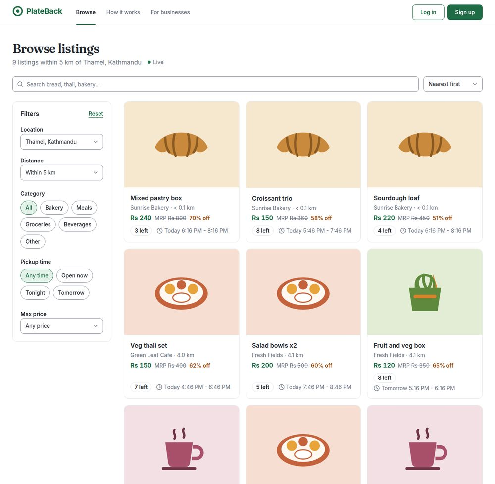
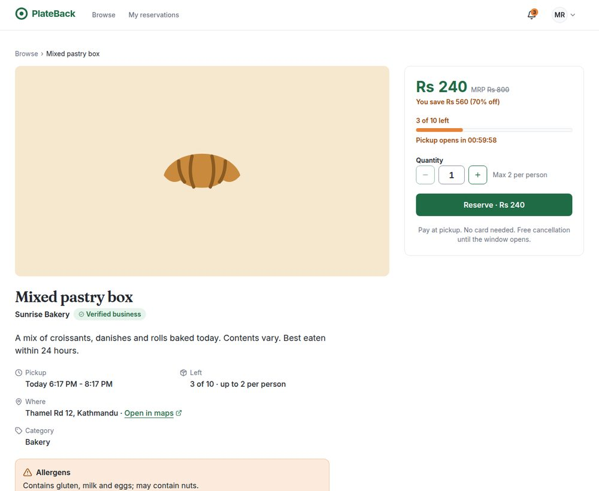
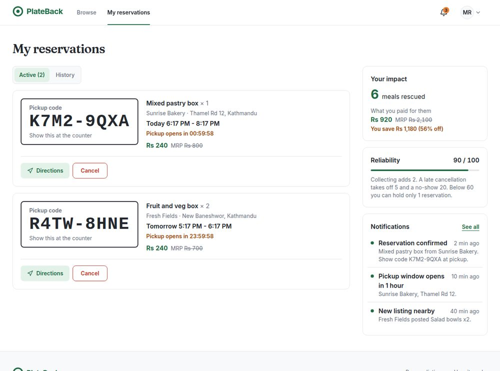
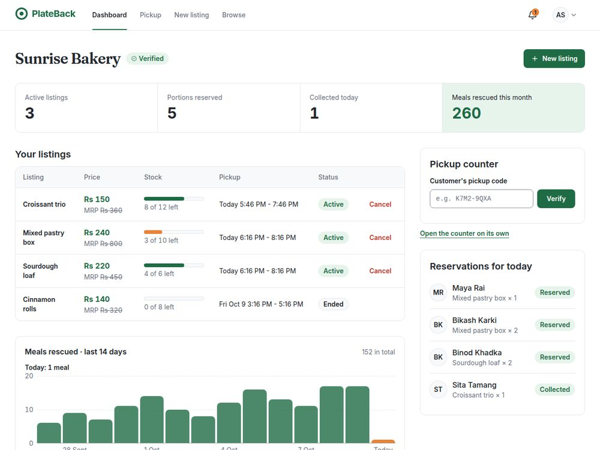
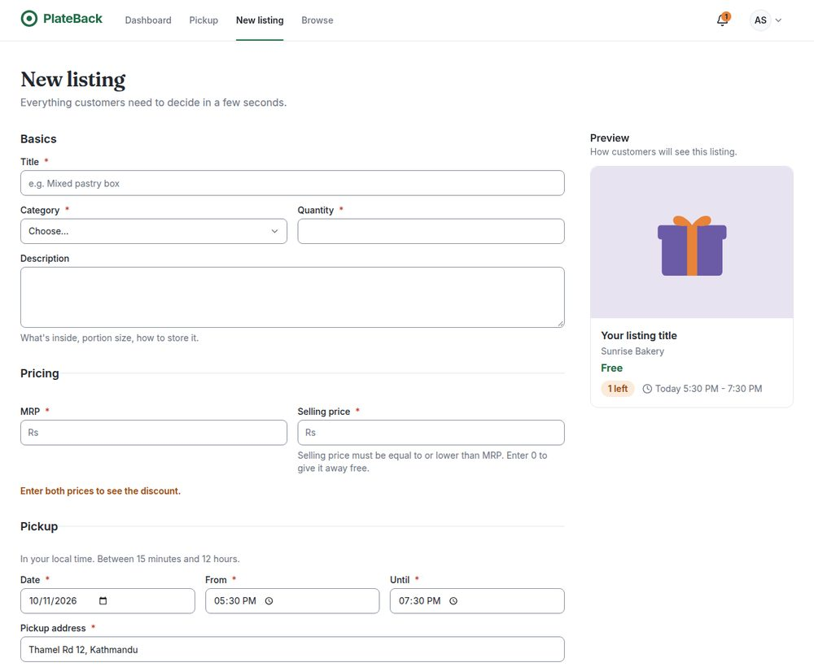
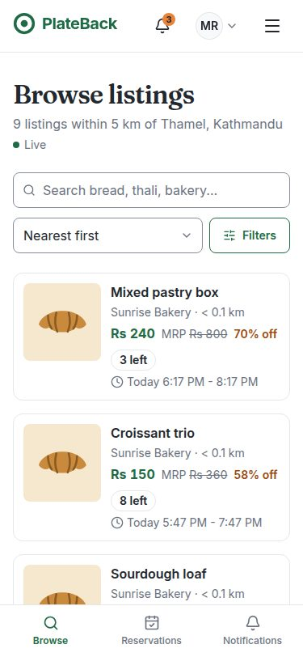
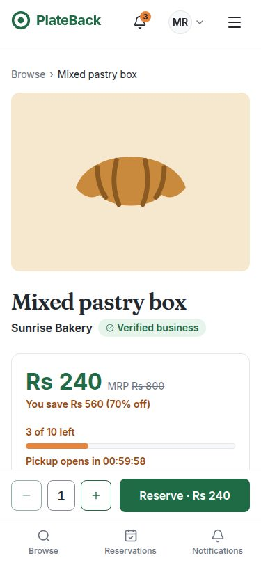
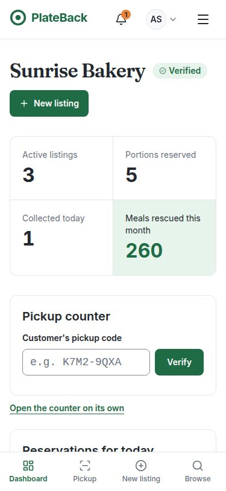

# PlateBack: frontend

PlateBack lets bakeries, cafes and restaurants list end-of-day surplus food, and lets people nearby reserve it and collect it during a short pickup window with a pickup code. This repository is the React frontend (Week 2 of the YuvaIntern programme). It runs against a mock API in the browser until the ASP.NET Core backend is ready.



## Contents

- [Run it locally](#run-it-locally)
- [What you can do](#what-you-can-do)
- [Tech stack](#tech-stack)
- [Project structure](#project-structure)
- [Design patterns](#design-patterns)
- [Visual design](#visual-design)
- [Mock API](#mock-api)
- [Accessibility](#accessibility)
- [Responsive design](#responsive-design)
- [Testing](#testing)
- [Development process](#development-process)
- [Known limitations](#known-limitations)

## Run it locally

Requirements: **Node.js 22.22 or newer** (developed on Node 24; see `.nvmrc`) and npm.

```bash
npm ci            # install the exact versions from package-lock.json
npm run dev       # start the dev server, then open the URL it prints
```

No backend or setup is needed: the mock API starts automatically. To change settings, copy `.env.example` to `.env`.

### Demo accounts

Every account uses the password **`password123`**. On the login page, open **Try a demo account** and choose **Fill in**.

| Role           | Email                       | Try                                                                 |
| -------------- | --------------------------- | ------------------------------------------------------------------- |
| Customer       | maya@example.com            | Reserve food, see pickup codes, cancel, notifications               |
| Business owner | arjun@sunrisebakery.example | Dashboard, verify a pickup code (try `K7M2-9QXA`), create a listing |
| Admin          | admin@plateback.example     | Verify, reject or suspend businesses                                |

Demo changes are saved in your browser. **Demo tools** in the footer has **Reset demo data**, which starts again from the original data.

### Scripts

| Command             | What it does                                 |
| ------------------- | -------------------------------------------- |
| `npm run dev`       | Dev server with hot reload                   |
| `npm run build`     | Type check and production build into `dist/` |
| `npm run preview`   | Serve the production build                   |
| `npm test`          | Tests in watch mode                          |
| `npm run test:run`  | Tests once                                   |
| `npm run coverage`  | Tests with a coverage report                 |
| `npm run lint`      | ESLint (including accessibility rules)       |
| `npm run typecheck` | TypeScript only                              |
| `npm run format`    | Format all files with Prettier               |

### Environment variables

| Variable               | Default   | Purpose                                                      |
| ---------------------- | --------- | ------------------------------------------------------------ |
| `VITE_API_BASE_URL`    | `/api/v1` | Where API requests go                                        |
| `VITE_USE_MOCKS`       | on        | Set to `false` to use a real backend instead of the mock API |
| `VITE_CURRENCY_SYMBOL` | `Rs`      | Symbol shown before prices                                   |

## What you can do

The app has 12 pages, all linked through role-based navigation.

| Page                                       | Route                      | Who                                   |
| ------------------------------------------ | -------------------------- | ------------------------------------- |
| Landing                                    | `/`                        | Everyone                              |
| Browse and search (the customer dashboard) | `/browse`                  | Everyone                              |
| Listing detail and reserve                 | `/listings/:id`            | Everyone (reserving needs an account) |
| My reservations                            | `/me/reservations`         | Signed in                             |
| Notifications                              | `/me/notifications`        | Signed in                             |
| List your business                         | `/org/new`                 | Signed in                             |
| Business dashboard and pickup counter      | `/org/:orgId`              | Members of that business              |
| Pickup counter (phone at the till)         | `/org/:orgId/pickup`       | Members of that business              |
| Create listing                             | `/org/:orgId/listings/new` | Members of that business              |
| Organization review                        | `/admin/organizations`     | Admins                                |
| Log in / Create an account                 | `/login`, `/register`      | Visitors                              |

Main flows, from the design document:

1. **Find and reserve.** Choose an area or use your location, then filter by category, price, pickup time and distance. Open a listing and reserve up to 2 portions to get a pickup code. If someone else took the last portion first, you see a clear "no longer available" message and the stock refreshes.
2. **Pickup.** My reservations shows each pickup code with a countdown. Cancelling before the window opens is free; after that it counts as a late cancellation (−5 reliability), and the confirmation says so first.
3. **Business.** Register a business, which starts as Pending until an admin verifies it. Then publish listings (with a live preview), watch stock, and verify customers' codes at the counter.
4. **Admin.** Review the queue, verify, reject (a reason is required) or suspend businesses. The owner is notified.

|                                                                |                                                          |
| -------------------------------------------------------------- | -------------------------------------------------------- |
|          |  |
|  |    |

## Tech stack

Versions are pinned exactly in `package.json`.

| Area          | Library                                      | Why                                                                         |
| ------------- | -------------------------------------------- | --------------------------------------------------------------------------- |
| UI            | React 19, TypeScript 6                       | Components with strict types end to end                                     |
| Build         | Vite 8                                       | Fast dev server; production build split into cached chunks                  |
| Routing       | React Router 8                               | Data router with lazy-loaded pages and route guards                         |
| Server state  | TanStack Query 5                             | Caching, background refresh, retries, refreshing related data after changes |
| Styling       | Tailwind CSS 4                               | Design tokens in CSS (`src/styles/index.css`), no config file               |
| Components    | shadcn/ui on Radix                           | Accessible dialogs, menus, tabs and sheets, restyled to our tokens          |
| Forms         | React Hook Form + Zod 4                      | Form state, and validation rules that mirror the server's                   |
| Mock API      | MSW 3                                        | Intercepts `fetch` in the browser and in tests                              |
| Tests         | Vitest 5, Testing Library, user-event        | Component and full-app tests in jsdom                                       |
| Quality       | ESLint 9 (+ jsx-a11y, React Hooks), Prettier | Linting, including accessibility, and consistent formatting                 |
| Icons, toasts | lucide-react, sonner                         |                                                                             |
| Fonts         | Inter, Fraunces (Fontsource)                 | Self-hosted; Fraunces only for page titles and the landing headline         |

Two packages are held back on purpose: TypeScript 6 and ESLint 9, because typescript-eslint and eslint-plugin-jsx-a11y do not support the newest major versions yet.

## Project structure

The code is grouped by feature rather than by file type (design document section 4.3):

```
src/
  app/                    application shell
    layout/               header, navigation (desktop, mobile drawer, tab bar), footer, layouts
    providers/            React Query, auth and toasts
    router/               route table, route guard, 404 / 403 / error pages
  features/               one folder per feature
    auth/                 login, register, session (access token in memory)
    listings/             landing, browse, listing detail, create listing
    reservations/         my reservations, cancel
    organizations/        business dashboard, pickup counter, create business
    notifications/        notification list and bell
    admin/                organization review
      (each has) api/ components/ pages/ schemas/
  shared/
    api-client/           the only code that talks to the network
    mocks/                mock API: seed data, in-memory database, handlers
    ui/                   shared components (button, dialog, field, alert...)
    lib/, hooks/, types/  helpers, hooks, API types
  styles/index.css        design tokens and base styles
  test/                   test setup and the renderApp() helper
```

## Design patterns

- **Feature folders.** Each feature owns its pages, components, API hooks and form schemas, and features talk through their public hooks.
- **One API client (adapter).** `shared/api-client/client.ts` wraps `fetch`: base URL, JSON, the bearer token, and turning error responses into a typed `ApiError`. It also refreshes an expired token once and retries. Pages never call `fetch` directly, so switching from the mock to the real backend is a configuration change.
- **Query option factories.** Every feature exposes `queryOptions` factories with query keys defined in one place, for example `listingsQuery(params)`. After a change, mutations refresh exactly the related data; reserving updates the stock, your reservations and the notification count.
- **The server decides.** Stock, limits and permissions are checked by the API. The UI shows the API's answer, for example a 409 "sold out", and refreshes, instead of trusting its own copy.
- **State in the URL.** Browse filters, pagination and tabs live in the URL, so they can be bookmarked or shared and the back button works.
- **Route guards.** `RequireAuth` protects routes by rule (signed in, business member, admin), following the design document's authorization matrix. The API enforces the same rules.
- **Schema-validated forms.** Zod schemas mirror the server's rules. Server validation errors are mapped back onto the matching fields.
- **Design tokens.** Colours, type scale and radii are defined once as CSS variables, with a measured contrast ratio noted for each.

## Visual design

The brand stays green with an orange accent and the ring logo. The rules below keep the screens consistent; the tokens live in `src/styles/index.css`.

- **Money.** Prices are in Nepali rupees, written "Rs 450" with Indian digit grouping ("Rs 1,25,000"), and 0 is "Free". Every price goes through `formatMoney()` (`shared/lib/money.ts`) and the `<Price>` component: the selling price large and green, then the MRP struck through, then the saving ("63% off" on cards, "You save Rs 250 (63% off)" on the listing). The API fields are still `price` and `originalPrice`.
- **Colour roles.** A green background means either _selected_ (`--selected`: chips, tabs, menu items) or _success_ (`--success-tint`: badges, alerts). Neutral panels use `--surface`; urgency (few left, countdowns) uses orange text on `--highlight-tint`. Each pair has its contrast ratio next to it.
- **Type.** Inter for everything, with tabular numbers for prices and counts. Fraunces for page titles (32 px) and the landing headline (44 px, 32 px on phones). Sizes come from one scale: 14, 16, 18, 20, 24, 32, 44 px.
- **Shape and depth.** Two radii: 8 px for inputs, buttons and small blocks, 12 px for cards. Shadows only on things that float (menus, sheets, dialogs); cards use a border, which turns green on hover. Transitions are short (150 ms) colour and opacity changes.
- **Shared pieces.** `PageHeader` (every page title), `Select` (native select, styled), `Price`, `MoneyInput`, `Skeleton`, `LiveDot`, and a `destructive-outline` button for cancel and reject.
- **Fixed bars on phones.** The tab bar and the listing page's reserve bar publish their heights as CSS variables (`--tab-bar`, `--bottom-bar`), so the page padding and toasts always clear them.

### Listing images

The seeded demo listings have no photos, so each shows a flat illustration for its category (croissant, thali, grocery bag, cup or gift) on a warm tint. If a listing has an `imageUrl`, the photo is shown instead; one that fails to load falls back to the illustration.

A business can add an optional photo when creating a listing (JPEG, PNG or WebP, up to 10 MB). The browser scales it down to 1280 px wide as a JPEG, previews it in the form and the customer card, and uploads it only on publish:

1. `POST /uploads/images` (multipart, field `file`) returns `201 { "url": "..." }`, or `400 VALIDATION_ERROR` with a `file` field error.
2. `POST /organizations/{orgId}/listings` sends that URL as the optional `imageUrl`.

This endpoint is not in the design document yet; the real API needs it (storing the file and returning a public URL). The mock returns a `data:` URL, so the photo is kept with the rest of the demo data in localStorage. That storage holds about 5 MB, enough for roughly ten photos; after that, new changes still work but are not saved across a reload.

## Mock API

There is no backend yet, so MSW intercepts requests to `/api/v1/*` and answers like the real API described in design document section 6:

- **Same contract:** the same endpoints, JSON shapes and error format (RFC 9457 ProblemDetails with codes such as `SOLD_OUT` and `LIMIT_REACHED`), so the frontend is built against the real contract.
- **Business rules:** stock that never goes negative, 2 portions per listing, 3 active reservations (1 below 60 reliability), late-cancel and no-show penalties, pickup codes that only work for their own business, verification before publishing.
- **Expiry and realism:** listings expire and no-shows are recorded when a pickup window passes. Requests are delayed 400 ms so loading states are visible.
- **Seed data:** businesses around Kathmandu, Lalitpur and Bhaktapur, with pickup windows relative to the current time so the data never goes stale.

The code is in `src/shared/mocks/`. It is loaded only when mocks are on, so it is not part of the bundle when `VITE_USE_MOCKS=false`. Week 3 builds the real API; Week 4 switches the flag off.

## Accessibility

Target: WCAG 2.1 AA (design document section 3.2).

- **Measured:** Lighthouse accessibility score of **100** on every page, at mobile and desktop settings, and no axe violations (WCAG 2.1 A/AA and best practice) at 360 and 1280 px.
- **Contrast:** every text colour is chosen for at least 4.5:1, and form field borders for 3:1. The ratios are noted next to each token in `index.css`.
- **Structure:** semantic landmarks, one `h1` per page, a skip link, and a page title per route.
- **Forms:** every field has a visible label. Errors and hints are linked with `aria-describedby`, and errors are never shown by colour alone.
- **Keyboard:** full keyboard use with a visible focus ring. Dialogs, menus and the mobile drawer trap and return focus (Radix).
- **Announcements:** stock changes and form results are announced through polite live regions. The countdown is hidden from screen readers in favour of a calm "2 h 14 min" text.
- **Accessible names:** they are tested. Text split across elements can lose its spaces ("Pending3"), so the tests check the names screen readers actually hear.
- **Motion:** respects `prefers-reduced-motion`. Touch targets are at least 44 px on mobile.

## Responsive design

The layout is mobile first, using Tailwind's breakpoints (768, 1024 and 1280 px) from a 360 px minimum.

- **Below 768 px:** the navigation becomes a drawer plus a bottom tab bar, browse filters move to a bottom sheet, listing cards become compact rows, the business listings table becomes stacked rows, and the pickup counter moves to the top of the dashboard.
- **Below 1024 px:** the listing page keeps the quantity and Reserve button in a bar fixed to the bottom of the screen, above the tab bar.
- **Checked in Chrome:** no horizontal scrolling on any page, for every role, at 360, 375, 768, 1024, 1280 and 1440 px.

|                                                      |                                                        |                                                            |
| ---------------------------------------------------- | ------------------------------------------------------ | ---------------------------------------------------------- |
|  |  |  |

## Testing

```bash
npm run test:run   # 119 tests in 23 files
```

- **Full-app tests** (`renderApp()` in `src/test/`) render the real app (providers, router, auth) against the mock API, and act like a user would: clicking labelled buttons and typing into labelled fields. They cover reserving (including the sold-out conflict), cancelling, verifying pickup codes, publishing a listing, admin review, login with redirect, route guards, navigation per role, the mobile menu and the skip link.
- **Mock API tests** check the business rules, for example that the last portion can only be reserved once (goal G1).
- **Unit tests** cover the API client, formatting, browse filter URL handling and form schemas.

Requests to anything that is not mocked fail the test, and the mock data resets after every test.

## Development process

1. **Week 1 design.** The design document (project brief, flows, wireframes, architecture, API) defines the screens, tokens, routes and API contract used here.
2. **Small, reviewed steps.** Setup, design tokens and the app shell, then the mock API, then one page at a time, then login. Every step ran lint, type check, formatting, tests and the build before moving on.
3. **Checked in a real browser.** Pages were checked in headless Chrome: screenshots at desktop and mobile widths, horizontal overflow at six widths, keyboard focus order, and Lighthouse. This found real bugs the unit tests could not:
   - a crash in the listing preview
   - an off-screen label that widened the mobile page
   - two contrast failures
   - accessible names missing spaces

## Known limitations

These are planned for later weeks:

- **Backend:** data comes from the mock API until Week 4. Live updates use 15-second polling; SignalR comes with the real backend (design decision D12).
- **Time zones:** times are entered and shown in the browser's time zone. The backend stores UTC and each organization's time zone.
- **Not built in Week 2 (lower-priority features):** recurring listings (F09), email notifications (F20), editing a listing, team management (F06), admin users, and the audit log screen.
- **Location:** no map or address lookup (design document 1.7). Locations come from preset areas or the browser's geolocation.
- **Performance:** with the mock API on, the app waits for the mock service worker before its first render. Performance tuning is part of Week 5.
